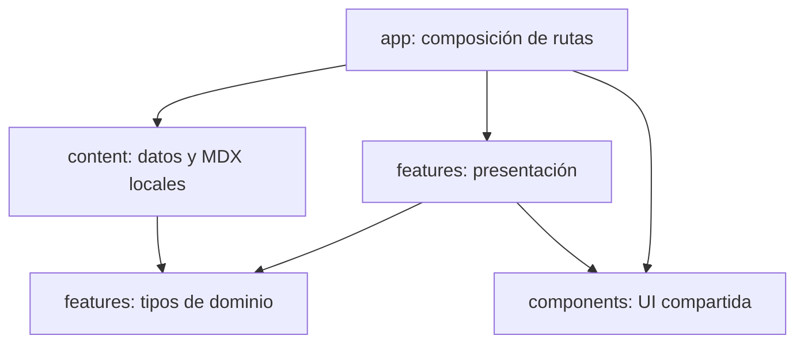

# Arquitectura del portfolio

Estado: descripción del código entregado · 6 de noviembre de 2026.

## Visión

Aplicación Next.js App Router con React, TypeScript strict y contenido local. Las páginas y el layout son Server Components; Next prerenderiza las rutas de contenido. Las interacciones usan componentes cliente acotados. No existe backend de negocio, CMS ni persistencia remota.

## Estructura física

```text
src/
  app/                         # Routing, layout, metadata y CSS global
    (spanish)/                 # Rutas existentes en español
    (english)/en/              # Rutas equivalentes en inglés
  views/                       # Vistas compartidas por idioma
  i18n/                        # Diccionarios, URLs y metadata
  content/
    profile.ts
    projects.ts
    credentials.ts
    case-studies/*.mdx
  features/
    projects/
      domain/project.ts
      components/
      case-study-registry.tsx
    credentials/
      domain/credential.ts
      components/
    lab/
      domain/experiment.ts
      components/
  components/                  # Shell y composición compartida
    ui/button.tsx              # shadcn/ui adaptado
  lib/utils.ts                 # cn: clsx + tailwind-merge
  mdx-components.tsx
tests/
  unit/
  e2e/
.github/workflows/ci.yml
```

La organización por idioma se detalla en [ADR-0009](technical-decisions/0009-internationalization.md).

## Límites y dependencias



El dominio no importa React, Next ni componentes. `content` satisface contratos de dominio mediante tipos y `satisfies`; las páginas pasan datos a las features. Los componentes compartidos no deben importar contenido de una feature concreta. El registro MDX es un adaptador de composición situado en la feature de proyectos; no forma parte del dominio puro.

La separación es pragmática: el shell combina rutas compartidas, mensajes de navegación y perfil. Las vistas reciben el idioma y seleccionan los textos editoriales. No hay capa de repositorios o servicios abstractos para lecturas locales. ESLint no implementa actualmente una regla automática de fronteras de módulos; estas dependencias se revisan en PR.

## Renderizado y límites Server/Client

| Elemento                    | Ejecución                    | Motivo                                                                      |
| --------------------------- | ---------------------------- | --------------------------------------------------------------------------- |
| Layout y páginas            | Server Component / prerender | Contenido estático y metadata                                               |
| Casos MDX                   | Compilación e import local   | Narrativas confiables sin CMS                                               |
| Navegación                  | Cliente                      | Ruta activa, apertura móvil y Escape                                        |
| ThemeProvider / ThemeToggle | Cliente                      | Preferencia de tema y persistencia                                          |
| ProjectExplorer             | Cliente                      | Filtros y búsqueda inmediatos                                               |
| CredentialCatalog           | Cliente                      | Filtro de categoría                                                         |
| DataExperiment              | Cliente                      | Slider y cálculo de subconjunto                                             |
| Transición de página        | Cliente                      | Motion y preferencia de movimiento reducido                                 |
| ProjectCard                 | Sin directiva cliente propia | Puede renderizarse en servidor o incorporarse al bundle de su padre cliente |

Un archivo sin `use client` no es necesariamente exclusivo del servidor: sus importadores determinan si forma parte de un subárbol cliente. Pasar children de servidor a un provider cliente no convierte automáticamente todo ese contenido en cliente.

## Modelo de contenido

### Project

`slug`, `kind`, `title`, `category`, `summary`, `technologies`, `concepts`, `evidence`, `repository` y `result`. `Technology` se limita actualmente a React, Next.js, Angular y TypeScript.

`evidence` admite `self-reported` y `repository-verified`. Los tres casos existentes son `self-reported`. El estado no valida automáticamente el repositorio: cambiarlo requiere una revisión humana. La página de detalle todavía presenta un aviso fijo de caso en documentación; al incorporar casos verificados hay que adaptar ese aviso, no solo el dato del catálogo.

### Credential

`id`, `title`, `type`, `institution`, `date`, `skills`, `verificationUrl`, `source`. `type` distingue `academic` y `course`. Institución y enlace pueden ser `null`; la fecha existente es un string ISO completo. No inventar una fecha si una nueva credencial solo tiene año: ampliar el contrato y su presentación si se necesita esa precisión.

Las fechas se muestran con `es-AR` o `en-US` y UTC para evitar desplazamientos de día según el huso del visitante. `futureEducation` permanece separado del catálogo de credenciales obtenidas. El campo `source` documenta procedencia; no se muestra como enlace de verificación pública.

### Datos de laboratorio

Seis observaciones sintéticas con identificador, complejidad y duración. `summarize` selecciona por complejidad máxima y calcula media redondeada. Devuelve `null` si no hay filas. No existe un modelo de IA ni un dataset externo.

## Flujo de un caso MDX

1. La ruta obtiene `slug` desde `params` asíncronos.
2. Busca el proyecto en `src/content/projects.ts`.
3. Resuelve el elemento MDX en `case-study-registry.tsx`, mediante imports explícitos.
4. Si falta proyecto o contenido, ejecuta `notFound()`.
5. `generateStaticParams` declara los slugs y `dynamicParams = false` limita las rutas generadas.
6. `generateMetadata` toma título, resumen y canonical del caso.

Al agregar un caso se deben actualizar el catálogo, los archivos MDX de ambos idiomas y el registro. TypeScript comprueba la cobertura de cada slug en el registro bilingüe.

## Estado, búsqueda y persistencia

Los filtros usan `useState`: no se sincronizan con query parameters, no persisten al recargar y no hay store global. La búsqueda recorta espacios y compara texto en minúsculas sobre título, resumen, conceptos y tecnologías. Se combina con la tecnología mediante AND. No elimina tildes ni implementa fuzzy search.

`next-themes` persiste la elección claro/oscuro y parte de la preferencia del sistema. No se almacenan datos personales del visitante.

## Entrega y hosting

| Modo      | Build                              | Servir                                                          |
| --------- | ---------------------------------- | --------------------------------------------------------------- |
| Next Node | `npm run build`                    | `npm start`                                                     |
| Estático  | `STATIC_EXPORT=true npm run build` | Publicar `out/` con soporte para `ruta/index.html` y `404.html` |

Definir `NEXT_PUBLIC_SITE_URL` con el origen final al compilar. El modo estático no se sirve con `next start`. No hay Server Actions, ISR ni cookies de servidor. Si una futura funcionalidad los necesita, revisar [ADR-006](technical-decisions/0006-deployment.md) y la compatibilidad de exportación.

## Calidad y límites de evidencia

Vitest cubre dominio y componentes interactivos; Playwright define navegación, temas, responsive y axe. La CI separa formato, lint, tipos, unitarios, build y E2E. El detalle de resultados está en `docs/VALIDATION.md` del proyecto original: 9 tests aprobados; E2E/axe y revisión móvil pendientes. La vista de desarrollo tuvo un problema de interacción en el entorno remoto; el export estático sí fue verificado manualmente.

## Seguridad y evolución

MDX local y confiable; nunca compilar contenido arbitrario de visitantes. No incorporar secretos a `NEXT_PUBLIC_*`. Los enlaces externos usan `noopener noreferrer`. La privacidad del despliegue de Sites pertenece al hosting; el código exportado no incluye autenticación propia.

Introducir un CMS, API o autenticación exige un ADR que defina contratos, validación en runtime, errores, cache y fronteras de acceso. No convertir tipos TypeScript en una supuesta validación de datos externos.

Ver [índice de ADRs](technical-decisions/README.md), [features](features.md) y [sistema de diseño](design-system.md).
